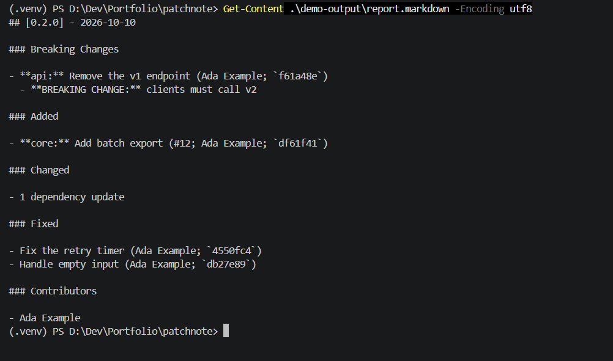

# Patchnote

**Turn git commits and merged pull requests into clean, human-readable changelogs and release notes.**

Patchnote is a Python CLI and GitHub Action. It groups history with Conventional Commits, PR labels, and conservative keyword heuristics, then writes [Keep a Changelog](https://keepachangelog.com/) (or conventional-changelog) markdown, JSON, or a GitHub Release body. An optional LLM step can polish wording. **The rule-based path is the product; AI is an enhancement, not a requirement.** AI is off by default. Generation reads local Git history; when a GitHub token is present, it also requests PR metadata.

## The problem

Release notes are either tedious (hand-written, then stale) or noisy (`git log --oneline` dumped into a GitHub Release). Tools that only understand labels miss local commits; tools that only understand Conventional Commits miss squash-merged PRs; tools that always call an LLM invent entries and leak private messages. Patchnote is the boring, inspectable middle: classify locally, enrich from GitHub when a token is present, rewrite with an LLM only if you ask.

## Install

Python 3.10+ and a `git` binary on `PATH`. Until the first PyPI release, install from this checkout with `pip install .`.

```bash
# isolated CLI
pipx install patchnote

# or uv
uv tool install patchnote

# or pip
pip install patchnote
```

From a clone (this is also how the GitHub Action installs itself, before the first PyPI release):

```bash
pip install .
```

## CLI quickstart

```bash
cd your-repo
patchnote init                          # commented patchnote.yaml
patchnote preview                       # HEAD since the latest tag, stdout only
patchnote generate --version 1.4.0      # markdown on stdout
patchnote generate --version 1.4.0 --output CHANGELOG.md --prepend
patchnote generate --format json
patchnote generate --format github-release
patchnote check --from v1.3.0           # CI linter for commit messages
patchnote release --version 1.4.0 --tag --push-release   # draft GH release; never publishes without --publish
```

Default range is *latest reachable tag matching `v*`* → `HEAD`. If there are no tags, Patchnote uses the full history. Empty ranges produce an empty section, not an error. With `--to vX.Y.Z`, the current tag is excluded from the default starting tag, so a tag-triggered release includes its changes.

Global flags: `--config`, `--repo`, `--no-color`, `--verbose`, `--version`. Place global flags before the command, for example `patchnote --repo path/to/repo generate`.

Exit codes: `0` success, `1` `check` found violations, `2` usage or config error, `3` runtime error (git or network).



## GitHub Action quickstart

```yaml
# .github/workflows/release.yml
name: Release
on:
  push:
    tags: ["v*"]
permissions:
  contents: write
jobs:
  notes:
    runs-on: ubuntu-latest
    steps:
      - uses: actions/checkout@v4
        with:
          fetch-depth: 0
      - uses: zahidhasann88/patchnote@v0.1.0
        with:
          version: ${{ github.ref_name }}
          create-release: true
          draft: true
```

The action is **composite**: it sets up Python, `pip install`s Patchnote from the action's own checkout (so it works before the first PyPI release), and runs `python -m patchnote.action_entry`. Inputs are passed as environment variables, never interpolated into a shell command.

| Input | Default | Notes |
| --- | --- | --- |
| `from`, `to`, `version`, `style` | (latest tag / HEAD / unset / config) | Same meaning as the CLI |
| `ai` | `none` | `none` \| `polish` \| `summary` \| `both` |
| `ai-base-url`, `ai-model`, `ai-api-key` | (config / empty) | Key is a secret input, never echoed |
| `output-file`, `prepend` | empty / `false` | Prepend is idempotent per version |
| `create-release`, `draft`, `publish` | `false` / `true` / `false` | Publication requires `publish: true`, even if `draft: false` |
| `github-token` | `${{ github.token }}` | Used for PR enrichment and releases |

Outputs: `changelog`, `release-url`, `unreleased-entries`.

Ready-to-copy workflows live in [`examples/workflows/`](examples/workflows/):

- **Tag push** → GitHub Release with generated notes
- **Pull request** → `patchnote check` + preview comment (documents fork-PR limitations)
- **workflow_dispatch** → update `CHANGELOG.md` and open a PR

## Sample input, sample output

Given these commits since `v1.3.0`:

```
feat(api)!: remove the v1 endpoint

BREAKING CHANGE: clients must call /v2

feat: add widget factory (#12)
fix: crash on empty input
fix the retry timer
chore: ignore me
chore(deps): bump requests from 2.31.0 to 2.32.0   (dependabot[bot])
Revert "feat: experimental flag"
    This reverts commit abcdef1.
```

`patchnote generate --version 1.4.0` prints:

```markdown
## [1.4.0] - 2026-10-10

### Breaking Changes

- **api:** Remove the v1 endpoint (`a1b2c3d`)
  - **BREAKING CHANGE:** clients must call /v2

### Added

- Add widget factory ([#12](https://github.com/acme/widgets/pull/12); @ada; `d4e5f6a`)

### Fixed

- Crash on empty input (`aa11bb2`)
- Fix the retry timer (`cc22dd3`)

### Changed

- 2 dependency updates

[1.4.0]: https://github.com/acme/widgets/compare/v1.3.0...v1.4.0
```

Chores are skipped, the revert cancels the original commit when both are in range, dependabot is collapsed, and the non-conventional "fix the retry timer" lands in **Fixed** marked as low-confidence internally (the marker is not shown in markdown).

## Classification rules

Precedence, first match wins:

1. **Breaking** — `!` after the type, a `BREAKING CHANGE:` footer, or a `breaking` / `breaking-change` label. Always rendered in a **Breaking Changes** section at the top, not duplicated elsewhere.
2. **PR labels** — mapped via `label_map` / `sections.*.labels` in config (e.g. `bug` → Fixed, `enhancement` → Added). Labels beat the conventional type so a `feat:` that was triaged as a bug still lands in Fixed.
3. **Conventional Commits** — `feat` `fix` `perf` `refactor` `docs` `test` `build` `ci` `chore` `revert`, with optional `(scope)` and `!`. Types are case-insensitive; a missing space after `:` is accepted.
4. **Keyword heuristics** — `fix`/`bug`/`hotfix`, `add`/`implement`, `remove`/`delete`, `deprecat`, `security`/`cve`/`xss`, `update`/`change`/`improve`. These are low-confidence.
5. **Other** — anything left. Patchnote does not guess wildly.

Filtering and cleanup:

- Skip `chore` / `ci` / `test` / `docs` / `build` / `style` by default (`--include-all` or config to keep them). A mapped PR label rescues a skipped type.
- Skip merge commits and `Merge branch` / `Merge pull request` subjects.
- Skip subjects matching `ignore_patterns` (defaults include `[skip changelog]`).
- Optionally skip bot authors, or collapse them into one "N dependency updates" line (default: collapse dependabot / renovate / `[bot]`).
- Dedupe commits that belong to the same PR (squash, merge, or `(#123)` in the subject).
- Collapse a revert with the commit it reverts when both are in range; a revert of something already released is kept.

Each entry can include a cleaned summary (sentence case, no trailing period by default), scope, PR number and link, author handle, and commit hashes. Contributors can be listed, with first-time contributors marked when GitHub data is available.

`--style conventional` groups as Features / Bug Fixes / Performance / … instead of Added / Fixed / ….

## GitHub enrichment

When `GITHUB_TOKEN` or `--token` is set and the remote (or `repository:` in config, or `GITHUB_REPOSITORY`) looks like GitHub, Patchnote resolves each commit to its merged pull request(s) via GraphQL (`associatedPullRequests`) with REST `/commits/{sha}/pulls` as fallback. Enrichment adds title, number, labels, author, and linked issues.

**If the API is missing, rate-limited, unauthorized, or on fire, Patchnote warns and continues with commits only.** Enrichment never fails the run.

## AI mode (optional)

```bash
export OPENAI_API_KEY=sk-...          # or a local key; name is configurable
patchnote generate --ai polish --yes
patchnote generate --ai summary --yes
patchnote generate --ai both --yes \
  --ai-include-bodies                 # opt-in; off by default
```

Any OpenAI-compatible `/v1/chat/completions` endpoint works, including Ollama:

```yaml
ai:
  base_url: http://127.0.0.1:11434/v1
  model: llama3.1
  api_key_env: OPENAI_API_KEY    # Ollama ignores the key; the env var may be unset
```

The model **only rewrites entries that were already classified**. It is sent a JSON list and must return JSON with the same `id`s in the same order. Added, missing, reordered, or bullet-stuffed items are rejected; Patchnote falls back to the rule-based text and prints a warning. HTTP errors do the same.

`--ai polish` rewrites summaries for clarity and consistent tone. `--ai summary` adds a 2–3 sentence overview generated only from those entries.

Commit messages and PR titles are **untrusted**. They are placed in a delimited data block; PR bodies are not sent unless `--ai-include-bodies`. See [SECURITY.md](SECURITY.md) for the full threat model.

Before the first call Patchnote prints the endpoint, model, and what will be sent, and waits, unless `--yes`. Non-interactive sessions without `--yes` refuse to call the LLM. Responses are cached by content hash under `.patchnote-cache/`; a matching validated response is reused. API keys are not included in prompts, caches, or generated notes. Reports still contain commit text and contributor details; review them before sharing.

## Configuration

`patchnote init` writes a commented `patchnote.yaml`. All keys are optional. See [`examples/config/patchnote.yaml`](examples/config/patchnote.yaml) and the comments in the generated file for the full reference.

A Jinja2 template can replace the markdown renderer (`template: path/to/file.j2`). The default template ships inside the package.

Config is validated with Pydantic v2; errors name the field and the problem. Custom templates are trusted code and resolve relative to the configuration file.

## Comparison

Related tools include [release-drafter](https://github.com/release-drafter/release-drafter),
[git-cliff](https://github.com/orhun/git-cliff), and
[conventional-changelog](https://github.com/conventional-changelog/conventional-changelog).
Patchnote focuses on local Git history, optional PR enrichment, a Python API, and optional
LLM rewriting with structural validation. Compare the tools against your release workflow;
Patchnote does not attempt to cover every template, integration, or ecosystem.

## Limitations

- GitLab / Gitea / Bitbucket remotes are parsed as "not GitHub"; enrichment is skipped. Local generation still works.
- Squash merges without `(#123)` in the subject need a token to attach the PR.
- Heuristics are English-centric.
- The LLM cannot be forced to be truthful; validation only stops it from adding or dropping entries.
- `patchnote release --push-tag` needs network access to `origin`; it will not force-push.

## Roadmap

- GitLab merge-request enrichment
- Built-in changelog fragments (`changes/*.md`) as an extra input
- `patchnote explain` — show why each entry landed in its section
- Action marketplace listing (needs a public repo and icon assets)

## Local verification

```powershell
python -m venv .venv
.\.venv\Scripts\python.exe -m pip install -e ".[dev]"
.\.venv\Scripts\python.exe tools/demo.py
```

The demo creates a temporary Git repository, checks all formats and idempotent prepend,
and exercises valid and rejected responses from a local fake LLM. Its reports are saved
in `demo-output/`. No GitHub token or real LLM is used.

## Contributing

See [CONTRIBUTING.md](CONTRIBUTING.md). Please follow the [Code of Conduct](CODE_OF_CONDUCT.md). Security reports: [SECURITY.md](SECURITY.md).

## License

[MIT](LICENSE) © 2026 Zahid Hasan
